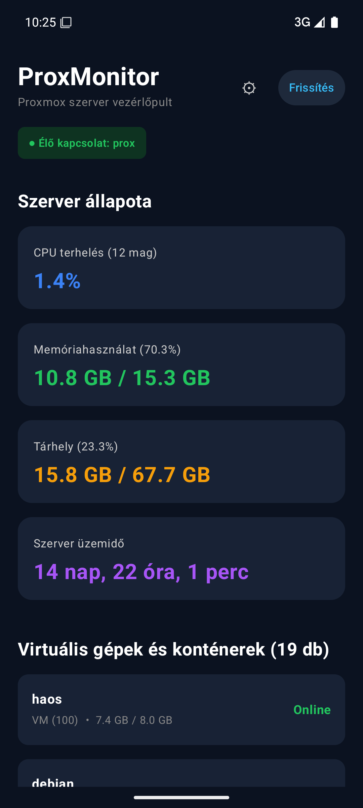

# ProxMonitor

> **Miskolci Egyetem – Mobilprogramozás tantárgyi beadandó (FOSZ)**  
> **Témakör:** REST API és JSON-feldolgozás Android-alkalmazásokban  
> **Szerző:** Mihalek Péter  
> **Aktuális verzió:** v0.3.0 (Teljesen működő Android kliens + FastAPI backend élő Proxmox kapcsolatban)

---

## 1. A projekt célja

A **ProxMonitor** egy modern, natív Android-alkalmazás, amely egy otthoni vagy intézményi **Proxmox Virtual Environment (PVE)** hipervizor állapotának valós idejű megfigyelését teszi lehetővé mobil eszközről.

A rendszer célja, hogy a szerverüzemeltető közvetlen webes felületre lépés nélkül, egy kézre álló mobilalkalmazásban ellenőrizhesse:
- A fizikai csomópont (node) hardveres kihasználtságát (12 CPU mag terhelése, memória- és háttértár-foglaltság, szerver üzemidő).
- A futó virtuális gépek (QEMU VM) és konténerek (LXC) állapotát (Online/Offline) és azok memóriafogyasztását.

A projekt a **Mobilprogramozás** tantárgy követelményeinek megfelelően a **RESTful hálózati kommunikáció**, az aszinkron **JSON-deszerializáció**, valamint a modern deklaratív **Jetpack Compose** felületépítés és egyszerű **MVVM** architektúra gyakorlati megvalósítását mutatja be.

---

## 2. Rendszerarchitektúra és technológiák

A rendszer három fő komponensből áll:

```text
┌─────────────────────────────────┐
│       ANDROID MOBIL KLIENS      │
│  - Jetpack Compose & Material 3 │
│  - MainViewModel & UiState      │
│  - Retrofit 2 & Gson konverter  │
└────────────────┬────────────────┘
                 │ HTTP / REST (JSON)
                 │ Fejléc: X-API-Key: <kulcs>
                 ▼
┌─────────────────────────────────┐
│       KÖZTES BACKEND API        │
│  - Python 3 + FastAPI           │
│  - Pydantic v2 adatmodellek     │
│  - Biztonságos tokenkezelés     │
└────────────────┬────────────────┘
                 │ HTTPS / REST (PVE API)
                 │ Fejléc: PVEAPIToken=root@pam!mobile=UUID
                 ▼
┌─────────────────────────────────┐
│       PROXMOX VE HYPERVISOR     │
│  - Fizikai gazdagép ('prox')    │
│  - 19 db QEMU VM és LXC konténer│
└─────────────────────────────────┘
```

### Felhasznált technológiák:

- **Mobil kliens (Android):**
  - **Nyelv:** Kotlin (100%-ban típusbiztos, null-safe)
  - **UI keretrendszer:** Jetpack Compose & Material 3 (deklaratív felület)
  - **Architektúra:** Egyszerű MVVM (Model-View-ViewModel) `StateFlow` állapotkezeléssel
  - **Hálózatkezelés:** Retrofit 2, OkHttp 3 és Gson Converter (JSON-feldolgozás)
  - **Aszinkronitás:** Kotlin Coroutines (`viewModelScope.launch`, `suspend fun`)
  - **Build rendszer:** Gradle Kotlin DSL (`.kts`)

- **Köztes Backend (Python / FastAPI):**
  - **Keretrendszer:** FastAPI & Uvicorn aszinkron ASGI szerver
  - **Adatvalidáció:** Pydantic v2 modellek
  - **Proxmox kommunikáció:** `httpx` aszinkron HTTP kliens
  - **Hitelesítés:** `X-API-Key` vagy `Authorization: Bearer`
  - **Biztonság:** A Proxmox API token kizárólag a szerver `.env` fájljában található, az Android APK nem tartalmaz szervertitkokat.

---

## 3. Funkciók és megvalósítási állapot

| Funkció | Leírás | Állapot |
| :--- | :--- | :--- |
| **Összesítő műszerfal** | Főképernyő a szerver állapotának áttekintésére | **Kész (v0.1.0)** |
| **CPU terhelés kártya** | Processzorterheltség és magok száma (12 mag) | **Kész (Élő adatokkal - v0.3.0)** |
| **Memória kártya** | RAM használat és százalék (10.8 GB / 15.3 GB) | **Kész (Élő adatokkal - v0.3.0)** |
| **Tárhely kártya** | Háttértár foglaltság és százalék (15.8 GB / 67.7 GB) | **Kész (Élő adatokkal - v0.3.0)** |
| **Szerver üzemidő** | Emberi formátumban kijelzett üzemidő (14 nap...) | **Kész (Élő adatokkal - v0.3.0)** |
| **VM / LXC lista kártyák** | 19 db valós entitás (`haos`, `debian`, `jellyfin` stb.) | **Kész (Élő adatokkal - v0.3.0)** |
| **FastAPI köztes réteg** | Python mikroszolgáltatás a PVE API lekérdezésére | **Kész (v0.2.0)** |
| **Dinamikus REST API hívás**| Valós idejű adatok lekérése a telefonról (Retrofit) | **Kész (v0.3.0)** |
| **Hiba- és állapotkezelés** | Töltésjelző, hálózati hiba, Újrapróbálkozás gomb | **Kész (v0.3.0)** |
| **Kapcsolati beállítások** | Szerver IP és kulcs futásidejű módosítása (⚙ gomb) | **Kész (v0.3.0)** |

---

## 4. Képernyőképek

### Élő működés a valódi Proxmox szerver adataival (v0.3.0):


---

## 5. Telepítés és indítás

### 5.1. A Python backend indítása (Fejlesztői gép)

1. Lépj be a backend könyvtárba, és másold le a konfigurációt:
   ```powershell
   cd backend
   Copy-Item .env.example .env
   ```
2. Töltsd ki a `.env` fájlban az egyedi mobil API-kulcsot (`PROXMONITOR_API_KEY`), valamint `LIVE` módban a Proxmox szervered adatait (`PROXMOX_HOST`, `PROXMOX_TOKEN_ID`, `PROXMOX_TOKEN_SECRET`). Éles (`LIVE`) módban a backend nem indul el az alapértelmezett példakulccsal.
3. Indítsd el a szervert:
   ```powershell
   .\.venv\Scripts\python run.py
   ```
4. A szerver alapértelmezetten a biztonságos `http://127.0.0.1:8000` címen fut. A Swagger UI elérhető a böngészőben: `http://127.0.0.1:8000/docs`.

### 5.2. Az Android alkalmazás fordítása és futtatása

- Nyisd meg a projekt gyökerét Android Studio-ban, vagy fordítsd parancssorból:
  ```powershell
  .\gradlew.bat assembleDebug
  ```
- Indítsd el az alkalmazást, majd a jobb felső sarokban található **⚙ Beállítások** gombbal add meg a `.env` fájlban beállított `PROXMONITOR_API_KEY` kulcsot:
  - **Android Emulátorban:** Alapértelmezetten a `http://10.0.2.2:8000/` címet használja, amely közvetlenül eléri a gazdagép `127.0.0.1:8000` portját.
  - **Távoli / éles eléréskor:** Az alkalmazás `network_security_config.xml` szabályai szerint külső címekhez HTTPS kapcsolatot vár el (pl. reverse proxy mögött).

---

## 6. Szakmai dokumentáció

A tantárgyhoz kapcsolódó részletes szakmai dokumentumok a [`docs/`](docs/) mappában találhatók:
- [Rendszerarchitektúra és adatáramlás](docs/architecture.md)
- [REST API specifikáció és JSON szerkezetek](docs/api.md)
- [Tantárgyi szakmai beadandó dolgozat](docs/beadando.md)
