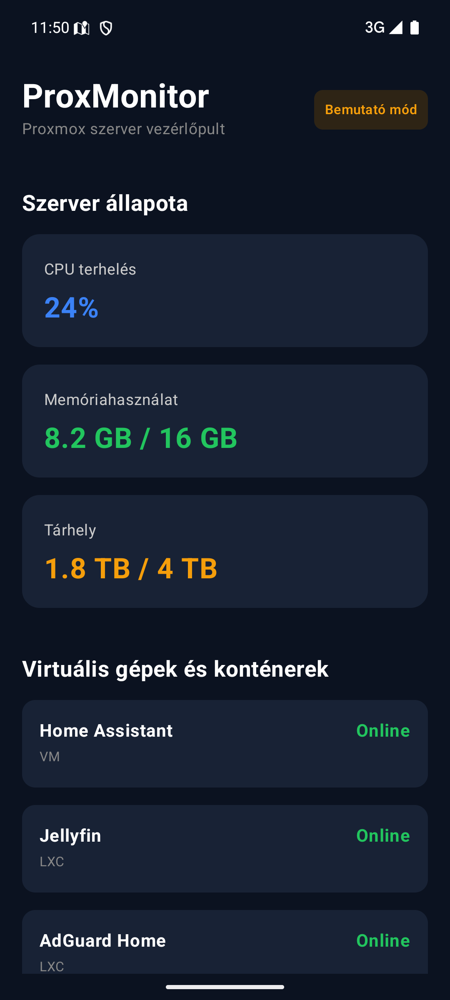

# ProxMonitor

> **Miskolci Egyetem – Mobilprogramozás tantárgyi beadandó**  
> **Témakör:** REST API és JSON-feldolgozás Android-alkalmazásokban  
> **Szerző:** Mihalek Péter  
> **Aktuális verzió:** v0.1.0 (Kezdeti állapot: Működő Jetpack Compose felület mintaadatokkal)

---

## 1. A projekt célja

A **ProxMonitor** egy modern, natív Android-alkalmazás, amely egy otthoni vagy intézményi **Proxmox Virtual Environment (PVE)** szerver állapotának valós idejű megfigyelését teszi lehetővé mobil eszközről.

A rendszer célja, hogy a szerverüzemeltető vagy rendszergazda közvetlen webes felületre lépés nélkül, egy kézre álló mobilalkalmazásban ellenőrizhesse:
- A fizikai csomópont (node) hardveres kihasználtságát (CPU, memória, háttértár).
- A futó virtuális gépek (QEMU/KVM VM) és konténerek (LXC) állapotát és erőforrás-fogyasztását.

A projekt kiemelt oktatási célja a **kliens-szerver architektúra**, a **RESTful hálózati kommunikáció**, az aszinkron **JSON-deszerializáció**, valamint a modern deklaratív **Jetpack Compose** felhasználói felület gyakorlati bemutatása.

---

## 2. Rendszerarchitektúra és technológiák

A rendszer három fő komponensből áll:

```text
┌─────────────────────────┐
│   Android Kliens        │ (Kotlin + Jetpack Compose + Retrofit)
└────────────┬────────────┘
             │ HTTPS / REST (JSON)
             ▼
┌─────────────────────────┐
│   Köztes Backend API    │ (Python + FastAPI) [Tervezett – 2. fázis]
└────────────┬────────────┘
             │ Proxmox REST API (API Token Auth)
             ▼
┌─────────────────────────┐
│   Proxmox VE Szerver    │ (PVE Node + QEMU VM + LXC)
└─────────────────────────┘
```

### Felhasznált technológiák:

- **Mobil kliens (Android):**
  - **Nyelv:** Kotlin (100%-ban típusbiztos, null-safe)
  - **UI keretrendszer:** Jetpack Compose & Material 3 (deklaratív felületépítés)
  - **Architektúra:** MVVM (Model-View-ViewModel) állapotkezelés [Tervezett integráció: v0.3.0]
  - **Hálózatkezelés:** Retrofit 2 & OkHttp 3, Kotlinx Serialization / Gson [Tervezett integráció: v0.3.0]
  - **Build rendszer:** Gradle (Kotlin DSL - `.kts`)

- **Köztes Backend (Tervezett – v0.2.0):**
  - **Nyelv & Keretrendszer:** Python 3 + FastAPI
  - **Hitelesítés:** Proxmox API Token (PVEAPIToken) biztonságos, szerveroldali tárolása
  - **Szerepe:** Védi a Proxmox API hitelesítő adatait; egyszerűsített, kifejezetten a mobilra optimalizált JSON válaszokat ad.

---

## 3. Funkciók és megvalósítási állapot

| Funkció | Leírás | Állapot |
| :--- | :--- | :--- |
| **Összesítő műszerfal** | Főképernyő a szerver állapotának áttekintésére | **Kész (v0.1.0)** |
| **CPU terhelés kártya** | Pillanatnyi processzorkihasználtság | Kész (Statikus mintaadat: 24%) |
| **Memória kártya** | Felhasznált / összes RAM kijelzése | Kész (Statikus mintaadat: 8.2 GB / 16 GB) |
| **Tárhely kártya** | Merevlemez/tárterület foglaltság | Kész (Statikus mintaadat: 1.8 TB / 4 TB) |
| **VM / LXC lista kártyák** | Név, típus (VM/LXC) és státusz (Online/Offline) | Kész (Statikus mintaadatok) |
| **Sötét téma (Dark Theme)** | Letisztult, szerver-dashboard stílusú sötét felület | **Kész (v0.1.0)** |
| **FastAPI köztes réteg** | Python mikroszolgáltatás a PVE API lekérdezésére | *Tervezett (v0.2.0)* |
| **Dinamikus REST API hívás**| Valós idejű adatok lekérése a telefonról | *Tervezett (v0.3.0)* |
| **Hiba- és állapotkezelés** | Betöltésjelző, hálózati hibák, Offline mód kezelése | *Tervezett (v0.4.0)* |

---

## 4. Képernyőkép

Az alkalmazás kezdőképernyője a Pixel 8 emulátoron futva (v0.1.0):



---

## 5. Telepítés és futtatás

### Követelmények:
- Android Studio Ladybug / Meerkat vagy újabb
- Android SDK (minSdk: 26 - Android 8.0 Oreo, targetSdk: 36)
- Java 11 / JDK 17+ (a Gradle futtatásához)

### Fordítás parancssorból (Windows PowerShell):
```powershell
# Debug APK fordítása
.\gradlew.bat assembleDebug

# Tesztek futtatása
.\gradlew.bat test
```

A lefordított APK fájl helye:
`app/build/outputs/apk/debug/app-debug.apk`

---

## 6. Dokumentáció

A részletes egyetemi és szakmai dokumentáció a [`docs/`](docs/) mappában található:
- [Rendszerarchitektúra és adatáramlás](docs/architecture.md)
- [REST API specifikáció](docs/api.md)
- [Tantárgyi beadandó dolgozat](docs/beadando.md)
- [Szóbeli védési segédlet és vizsgakérdések](docs/vedes.md)
